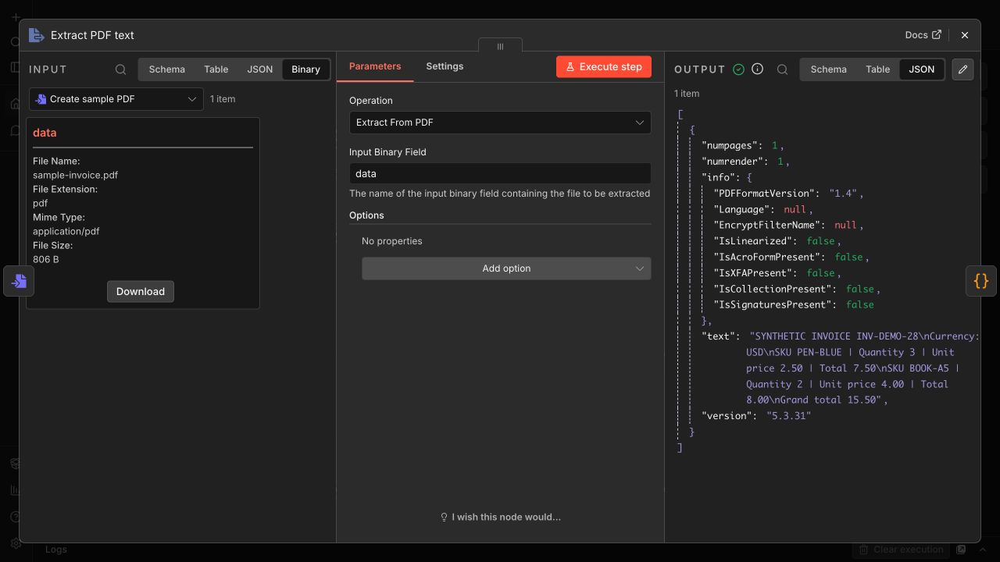
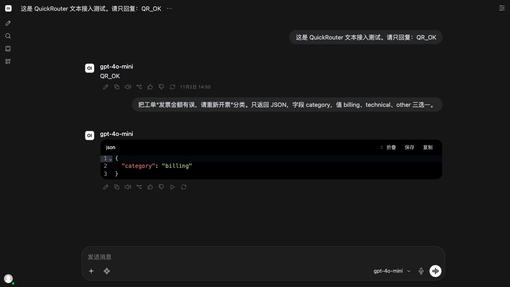
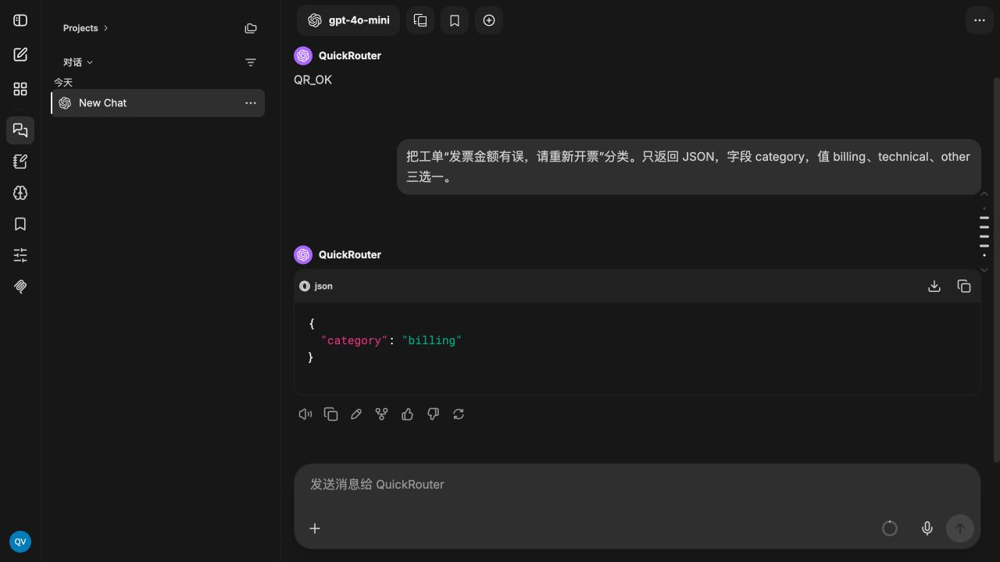

# QuickRouter integrations / 开源接入示例

Importable n8n workflows and tested Open WebUI / LibreChat configurations. Start with synthetic data and a short text-model task; inspect the real result before using business data.

提供可导入的 n8n 工作流、Open WebUI 和 LibreChat 配置。包含真实步骤、原生客户端截图和结果。模板与原创示例代码采用 MIT；QuickRouter API 按实际用量计费。

## Choose a task / 选择任务

| Task | Download | Verified result |
| --- | --- | --- |
| PDF invoice → validated CSV | [n8n workflow](n8n-pdf-invoice-to-csv.workflow.json) · [setup](n8n-invoice-README.md) | n8n 2.16.0; HTTP 200; 249 tokens; [two CSV rows](n8n-pdf-invoice-result.csv) |
| Chinese support-ticket triage | [n8n workflow](n8n-support-triage.workflow.json) | n8n 2.16.0; HTTP 200; [receipt](n8n-support-triage.receipt.json); [CSV](n8n-support-triage.result.csv) |
| Product translation with SKU/spec validation | [n8n workflow](n8n-product-translation.workflow.json) | n8n 2.16.0; HTTP 200; [receipt](n8n-product-translation.receipt.json); [CSV](n8n-product-translation.result.csv) |
| Open WebUI text chat | [environment fragment](openwebui.env.example) · [setup](openwebui-README.md) | 0.12.5-slim; QR_OK and billing classification; [receipt](openwebui-text-receipt.json) |
| LibreChat text chat | [YAML fragment](librechat.yaml) · [setup](librechat-README.md) | v0.8.9-rc1; QR_OK and billing classification; [receipt](librechat-text-receipt.json) |

The PDF and both client results were checked on 2026-11-02. Support and translation receipts are dated 2026-10-27 UTC; they are historical tests, not promises of current availability. LibreChat was tested on a release candidate.

## n8n quick start / n8n 使用步骤

1. Import one workflow JSON into a new workflow in your own n8n instance.
2. Create **HTTP Header Auth**: name `Authorization`; value `Bearer YOUR_QUICKROUTER_KEY` with one space after Bearer. Store your private key in Credentials, never exported JSON.
3. Select that credential on **QuickRouter text request**. Confirm the `gemini-2.5-flash-lite` model is available to your account and you have API credit.
4. Keep the included fictional sample and run once. Each valid run sends one bounded text request with no automatic retry.
5. Inspect **Validate result**, then **Export CSV → Download**. Review output before replying to customers or publishing products; these examples do neither automatically.

The invoice template needs a selectable-text PDF. Scans need separate OCR. Integer-cent checks and formula-safe CSV cells do not replace human review.

## Native screenshots / 原生截图

Connection and model-selection screenshots are also included. Client token estimates and incomplete usage fields are not gateway billing receipts.

## Guides / 在线教程

- [PDF invoice workflow and results](https://quickrouter.ai/integrations/visit/n8n-invoice/github)
- [Open WebUI setup and results](https://quickrouter.ai/integrations/visit/open-webui/github)
- [LibreChat setup and results](https://quickrouter.ai/integrations/visit/librechat/github)
- [API documentation](https://doc.quickrouter.ai/)

## Scope, cost and privacy / 范围、费用与隐私

- Tested with low-cost text models through `https://api.quickrouter.ai/v1`; no video, image or audio model runs are included.
- Configuration files contain placeholders, not real keys. The samples are synthetic. Never commit `.env`, credentials, private business files or runtime databases.
- 401: check credentials. 404: check the exact model ID and `/v1`. 429: check balance/access/channel availability before a bounded retry. DNS errors require checking both host and container connectivity.
- These are original integration examples, not upstream software distributions or official vendor endorsements. RAG, vision, voice, tool calling and general all-model compatibility are untested.
- Template approval, downloads and stars do not demonstrate successful API use, retention or revenue.

## Contribution status / 投稿状态

The n8n invoice template (#22204) is under human review; the other two have not been submitted. [LibreChat docs PR #904](https://github.com/LibreChat-AI/docs/pull/904) fixes an existing Azure YAML example and is pending maintainer review. It does not add a QuickRouter provider or endorse these examples.

## Verification / 校验

`SHA256SUMS` identifies the original files. Workflow hashes in receipts match their respective JSON downloads. No API request is made by downloading or inspecting the files.

Original examples: [MIT](LICENSE). n8n, Open WebUI and LibreChat retain their respective licenses and trademarks. See linked official documentation in the setup guides.
