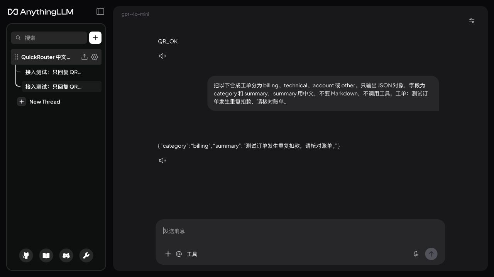
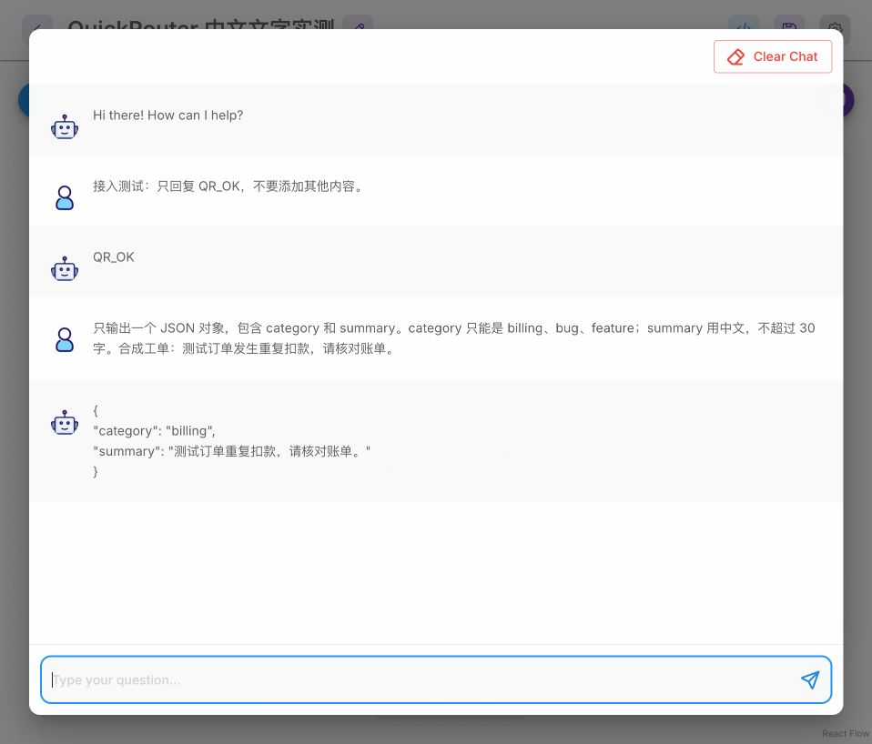

# QuickRouter 中文工作流与客户端接入示例

提供可导入的中文 n8n 模板、原生客户端配置、合成输入、截图和真实结果。模板免费，API 按实际用量计费；首次验证保留合成样例。Key 只保存在自己的私密凭据中。

## 六个中文业务工作流

2026-11-02 在 n8n 2.16.0 原生执行，最终六份成功回执共 **1,099 tokens**，统一使用 gpt-4o-mini，每次 max_tokens=600、stream=false、无自动重试。修订与异常调用另外计费；已记录历史调用 2,569 tokens，不代表完整账单总额。未调用视频、图片、音频或嵌入模型。

| 任务 | 下载与说明 | 最终实测 | 图文教程 |
| --- | --- | --- | --- |
| n8n 工单本地脱敏与摘要 | [导入 JSON](n8n-ticket-redaction-workflow.json) · [中文说明](n8n-ticket-redaction-README.md) | 1 条 / 135 tokens · [实际 CSV](n8n-ticket-redaction-actual-result.csv) | [原生截图与步骤](https://quickrouter.ai/integrations/visit/n8n-ticket-redaction/github) |
| n8n 销售线索字段提取与缺项提醒 | [导入 JSON](n8n-lead-extraction-workflow.json) · [中文说明](n8n-lead-extraction-README.md) | 1 条 / 173 tokens · [实际 CSV](n8n-lead-extraction-actual-result.csv) | [原生截图与步骤](https://quickrouter.ai/integrations/visit/n8n-lead-extraction/github) |
| n8n 评论精确去重与问题归类 | [导入 JSON](n8n-comment-deduplication-workflow.json) · [中文说明](n8n-comment-deduplication-README.md) | 2 条 / 168 tokens · [实际 CSV](n8n-comment-deduplication-actual-result.csv) | [原生截图与步骤](https://quickrouter.ai/integrations/visit/n8n-comment-deduplication/github) |
| n8n 中文会议文本转行动清单 | [导入 JSON](n8n-meeting-actions-workflow.json) · [中文说明](n8n-meeting-actions-README.md) | 1 条 / 186 tokens · [实际 CSV](n8n-meeting-actions-actual-result.csv) | [原生截图与步骤](https://quickrouter.ai/integrations/visit/n8n-meeting-actions/github) |
| n8n 多语言术语一致性检查 | [导入 JSON](n8n-terminology-check-workflow.json) · [中文说明](n8n-terminology-check-README.md) | 2 条 / 181 tokens · [实际 CSV](n8n-terminology-check-actual-result.csv) | [原生截图与步骤](https://quickrouter.ai/integrations/visit/n8n-terminology-check/github) |
| n8n 用户反馈生成 GitHub Issue 中文草稿 | [导入 JSON](n8n-feedback-issue-draft-workflow.json) · [中文说明](n8n-feedback-issue-draft-README.md) | 1 条 / 256 tokens · [实际 CSV](n8n-feedback-issue-draft-actual-result.csv) | [原生截图与步骤](https://quickrouter.ai/integrations/visit/n8n-feedback-issue-draft/github) |

1. 选择 Import from File 导入工作流。
2. 在 HTTP Request 选择 Header Auth：Name=Authorization，Value 为 Bearer 加一个空格及自己的 Key。
3. 执行合成样例，核对绿色节点、字段断言和“需人工确认”列，再下载 CSV。更换输入后同步修改提示词与校验规则。

精确去重不等于语义聚类；工单仅脱敏邮箱和中国大陆手机号；会议依据必须摘自原文；Issue 仅生成草稿，不自动发布。

## 两款新增客户端原生验证

### AnythingLLM

[中文说明](anythingllm-README.md) · [配置样例](anythingllm-quickrouter.env.example) · [实际结果](anythingllm-actual-result.json) · [验证回执](anythingllm-receipt.json) · [图文教程](https://quickrouter.ai/integrations/visit/anythingllm-quickrouter/github)

### Flowise

[中文说明](flowise-README.md) · [配置样例](flowise-flowise-text-chatflow.json) · [实际结果](flowise-actual-result.json) · [验证回执](flowise-receipt.json) · [图文教程](https://quickrouter.ai/integrations/visit/flowise-quickrouter/github)

AnythingLLM 1.19.0：Generic OpenAI、普通聊天模式、空文档工作区；两次成功回话由客户端报告 274 tokens，未独立核对账单。首次代理模式未完成，不计为 Agent 成功。

Flowise 3.1.4：三节点文字 LLM Chain，使用官方支持的隔离 PostgreSQL 17；原生记录无 token 统计，不估算消费。**官方已停止维护，仅供现有部署接入核对，不建议新生产部署。** [官方公告](https://flowiseai.com/sunset)。

两款均验证 QR_OK 和中文账单分类，max_tokens=256、stream=false；未验证知识库、Agent、工具或媒体能力。

## 已有工作流和客户端

- [PDF 发票转 CSV](n8n-pdf-invoice-to-csv.workflow.json) · [说明](n8n-invoice-README.md) · [实际 CSV](n8n-pdf-invoice-result.csv)
- [客服分类](n8n-support-triage.workflow.json) · [商品翻译](n8n-product-translation.workflow.json)
- [Open WebUI 配置](openwebui.env.example) · [说明](openwebui-README.md)
- [LibreChat 配置](librechat.yaml) · [说明](librechat-README.md)

## 上游贡献和审核状态

- n8n 发票模板 #22204 仍在人工审核，后续投稿入口尚未开放；其他模板没有宣称已被官方收录。
- [LibreChat 文档 PR #904](https://github.com/LibreChat-AI/docs/pull/904)：待维护者审核。
- [AnythingLLM 文档 PR #319](https://github.com/Mintplex-Labs/anythingllm-docs/pull/319)：说明上下文和输出上限，已提交，待审核；没有新增网关推广链接。上游 Vercel 检查要求维护者授权部署。

## 校验与许可

SHA256SUMS 标识公开文件；回执中的工作流 SHA256 与对应 JSON 一致。下载不发起 API 调用。原创示例采用 MIT；客户端与原项目保留各自商标和许可。Flowise 图结构依据官方随包 LLM Chain 示例和节点 schema，遵循 Apache-2.0；参见 [Flowise 许可](https://github.com/FlowiseAI/Flowise/blob/main/LICENSE.md)。
